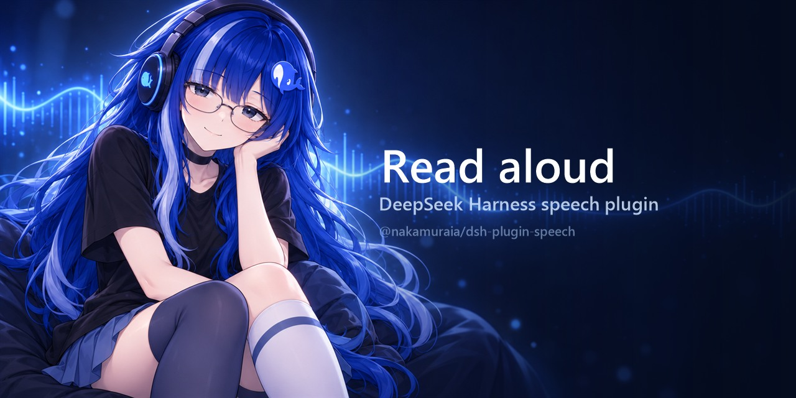

# dsh-plugin-speech

[English](README.md) | 中文



在 [DeepSeek Harness](https://github.com/deepseek-ai/deepseek-harness) 中朗读助手回复：每条回复一段连续的声音。

## 它做什么

每条已完成的助手消息在其操作行中多出一个播放控件。按下即朗读该回复，再按一次停止。「通用」设置中新增一行，用于选择服务、声音与调音。

整条回复以**一个请求**发出，主机在服务仍在合成时就把它流式回传。播放会在缓冲到几秒音频后才开始——普通回复约一秒——此后到最后一个字都是连续的一条声音：那段预缓冲正是让它在句中不会断粮的原因。

## 服务提供方

| 服务 | 需要密钥 | 声音 |
|---|---|---|
| **Microsoft Edge**（默认） | 否 | 该服务公开完整目录，覆盖其支持的所有语言 |

新增一个提供方，只需在 `src/providers/` 下加一个目录，并在 `src/providers/registry.ts` 中加一行——设置界面会根据该提供方声明的字段自动生成。

### Edge 令牌

每次握手都会携带一个短时效的 `Sec-MS-GEC` 令牌：把当前时间换算成 Windows 文件时间刻度、向下取整到五分钟，再与公开的客户端令牌一起摘要。2026 年 10 月，该端点改用**第二代**令牌——一个经过改动的 SHA-256 加上 64 位校验和——并开始对第一代令牌直接返回 `403`（`Edge TTS WebSocket error: Unexpected server response: 403`），而这正是「点了播放却始终没有声音」时浏览器看到的样子。`src/providers/edge/gec.ts` 复现了被接受的那一代令牌；`server.ts` 通过替换 `msedge-tts` 私有的 URL 构造函数把它交给客户端，端点现在要求的令牌版本同样由那里决定。若朗读再次失效，请先检查这个令牌：它是本插件中唯一会在代码不变的情况下过期的部分。

## 环境要求

- DeepSeek Harness 的 Web 界面（`dsh web`）或桌面应用，版本 `0.2.0-rc.2` 或更新。
- 能访问语音服务的网络。除此之外没有别的：无需下载模型，Edge 提供方也不需要账号。

版本下限并非装饰。插件自身条目的 Cordis 配置就是它的偏好设置，并通过 `ctx.configForms` 以表单形式暴露给设置界面。`0.2.0-rc.2` 之前的版本由插件自行注册设置命名空间（`settings.register`），并给浏览器一个 `ctx.settingsScope`；这两个服务都已不存在。

## 安装

本包声明了 `dsh.bundle.patch`，因此以 **profile bundle** 的形式安装：包管理器把它链接进来，启动器将其追加到该 profile 的 `dsh.profile.bundles`，再由 bundle 自带的 patch 层插入插件条目。安装即启用——在 DeepSeek Harness 中「安装」与「在某个 profile 中启用」本是两步，bundle 把两者合而为一。

**桌面应用** —— 侧边栏 → **Plugins** → **Add plugin**，然后给出以下之一：

- `@nakamuraia/dsh-plugin-speech`（npm registry）
- `github:NakamuraIA/dsh-plugin-speech`
- 本地检出目录的绝对路径

**命令行** —— 同一操作，作用域为某个 profile：

```sh
dsh plugin --profile web add github:NakamuraIA/dsh-plugin-speech
```

之后请重启界面。主机侧在插件加载时占用自身 HTTP 路由；桌面 profile 由应用独占管理；而新装入的 out-of-tree bundle 不会被在线重组挂载——加到 patch 里的应用内置条目会立即重载，需要来自 profile `node_modules` 的包则不会。

### 不安装，仅作一次性叠加层

`cordis.patch.yml` 与 bundle 所用的 patch 是同一个文件，因此也可作为临时命令行叠加层：

```sh
dsh web --patch ./cordis.patch.yml
```

**不要两者并用。** 当 bundle 已被选中时，profile patch 再插入 `ui-speech` 会以 `duplicate loader entry id` 冲突；profile 层应只用于覆盖该条目的配置，设置界面写入的也正是这一层。

**条目名**既是包名，也是构建产物注册所用的浏览器模块 id；**条目 id**（`ui-speech`）则是配置表单所依据的设置命名空间。两者任何一处漂移都会失效，因此必须同时修改。

## 设置

设置打开后位于**通用**分区，其中**朗读**一行负责：

- **服务**：由哪个提供方合成。
- **语言**与**声音**：要使用目录中的哪一个。
- **速度**、**音量**、**音高**：随每次请求发送给服务。
- **跳过代码**：朗读时不读围栏代码与行内代码。
- **试听**：按屏幕上的设置（保存与否都算）朗读一段示例。

该行编辑的是插件自身条目的配置，因此所选值随条目一起保存在 profile patch 中，而不是某个设置文档里。重置某个字段会恢复 schema 默认值；主机拒绝的写入不会改动已存值，同时该行会如实提示。

无论「跳过代码」如何设置，表格与粘贴的电子表格一律不读。该开关只决定围栏代码与行内代码是否朗读：关闭时，代码本身会被读出，仅去掉围栏标记。链接保留文字、丢弃地址；emoji、引号与孤立符号会被去掉。句末标点保留，因为语音用它来断句。

## 工作原理

```
浏览器                      主机                        服务
──────                      ────                        ────
点击 ─ ▶ POST /speech/speak { text }
                            从自身条目配置中
                            选出提供方
                            ────────────────────────── ▶ 合成
        ◀ ─ 音频字节持续回流 ─ ─ ─ ─ ─ ─ ─ ─ ─ ─ ─ ─ ─ ┘
缓冲四秒，随后边到达边播放
```

合成放在主机侧，因为浏览器既不能持有 API 密钥，也无法跨 CORS 访问大多数服务。浏览器只负责发文本、放字节。条目配置中每个可编辑叶子都是 `.volatile()`，因此一次设置写入会直接落到正在运行的主机侧，无需重新加载插件——主机读到的正是浏览器写入的那个值。

播放经 `MediaSource` 进行，**缓冲满四秒**音频后才开始，随后边接收边播放。那段预缓冲就是整个设计：不停顿地立刻开播，会在服务合成慢于朗读时反复卡住；等整个文件到齐虽然顺滑，却可能要等十秒。四秒足以显得即时——在热连接上实测约一秒——又足以保证句中不会断粮。若这条链路缺少某一环（没有 `MediaSource`、引擎拒绝该容器、缓冲中途失效），回复仍会被播放：用已收到的字节拼成一个完整文件。

只有超过单次请求上限（20000 字符）的回复才会退回「一句一请求」，那正是句子之间仍可能听到停顿的唯一情形。

此外，某些声音本身就在每句末尾留一段长静音——schema 默认的 `pt-BR-AntonioNeural` 每句约留 0.9 秒，而多语种声音一点不留。那段静音在服务返回的音频里，不在本插件的播放方式里。

## 开发

本仓库直接基于已发布的 `@deepseek-ai/*` 包独立构建，不需要 harness 检出目录：

```sh
pnpm install
pnpm build      # tsc → lib/types，tsdown → lib/index.js + lib/client.js
pnpm test       # vitest
pnpm typecheck  # 源码与测试
```

`build/plugin-bundle.ts` 是客户端 bundle 预设：它产出 `window.__ModuleLoader__.load` 交接、让每个模块表条目保持 `require`、把 CSS Modules 编译为一个注入的 style 标签，并在出现跨插件值导入时让构建失败。它是 harness 预设的自包含副本，也是本包能就地构建的原因。

`tests/checkout/` 下的三个测试组装真实的客户端注册表，而它们只以源码形式存在于 harness 检出目录中；原因与运行方式见 `tests/checkout/README.md`。其余部分（含客户端接线）都由 `pnpm test` 覆盖。

### 从 0.1.x 迁移

- 主机侧改为导出 `Config`——即叶子带 `.volatile()` 的 schemastery schema——不再调用 `settings.register`；合成路由读取 apply 时传入的条目配置。
- 客户端侧改用 `ctx.configForms.get('ui-speech')`，不再用 `ctx.settingsScope.bind(...)`；写入直接返回是否被接受（`Promise<boolean>`），不再拿落定后的段落做比对。
- `@deepseek-ai/dsh-client-ui-primitives` 的图标按字重命名（`IconPlayOutlineRegular`），不再按绘制尺寸（`IconPlayOutline16`）。

## 许可

MIT。Edge 提供方通过 [`msedge-tts`](https://github.com/harvey-woo/msedge-tts)（MIT）调用微软的朗读端点；该端点并非微软公开支持的 API，因此其可用性按尽力而为对待。
